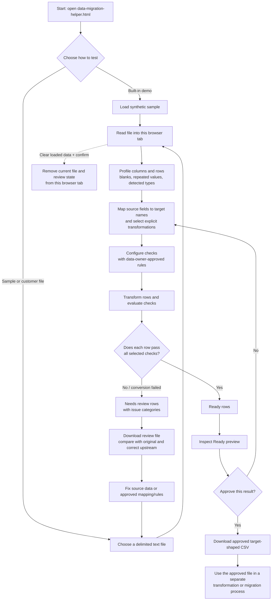

# Data Migration Helper: how the review workflow works

This guide explains what happens from file selection through approved export. The browser page processes the selected file locally in the browser; it does not connect to the Python CLI or a migration system.

## Process flow

## What each stage means

1. **Open and choose a file.** Open `examples/ui/data-migration-helper.html` in Edge or Chrome. Use **Load synthetic sample** for the quickest demo, or choose a CSV/TSV/delimited text file with unique column headers. The built-in synthetic sample is fictional.
2. **Profile.** The page counts records, fields, blanks, repeated values, distinct values, and detected types/ranges. These are clues for the reviewer, not a decision about whether data is valid for the business.
3. **Map and transform.** Keep source column names or rename them to target names. Choose only the explicit operations needed: trim/case, date or number/currency formatting, splitting on a specified delimiter, and combining two selected columns.
4. **Set checks.** Choose required, type, allowed-value, and uniqueness rules based on requirements confirmed by the data owner. The page does not know the intended schema or business rules by itself.
5. **Separate the rows.** Rows that pass all configured checks appear under **Ready**. Rows with failed checks or conversion problems appear under **Needs review**. The workflow does not silently discard or deduplicate them.
6. **Review and fix.** Inspect both previews. The review download contains original source values, proposed target values, source row references, and issue categories. Use it to locate and correct issues in the source or adjust only an approved mapping/rule, then run the file through the review again.
7. **Approve and export.** Confirm the Ready preview and approve it. Approval is temporary for the current browser session and current settings; changing a mapping, transformation, or rule revokes it. The approved CSV contains the transformed target columns and is downloaded to the browser's configured download folder.
8. **Continue separately or clear.** The page does not load the downloaded file into another migration product. A person must provide the approved CSV to the next process. To clear the in-memory data and review state, choose **Clear loaded data** and confirm. This does not delete the original file or files already downloaded.

## Important boundaries

- This is a browser-only prototype; it does not call the Python CLI, upload to a server, persist approvals, or execute a migration.
- A clean-looking Ready row is only known to pass the checks that were selected. It is not proof of business correctness.
- The review CSV includes row-level source data. Treat it and the approved export as sensitive, and save them only in an approved location.
- Local processing by this page does not prevent OneDrive, browser settings, or other device software from syncing or transmitting files. Check the privacy/security guidance before using anything other than synthetic data.
